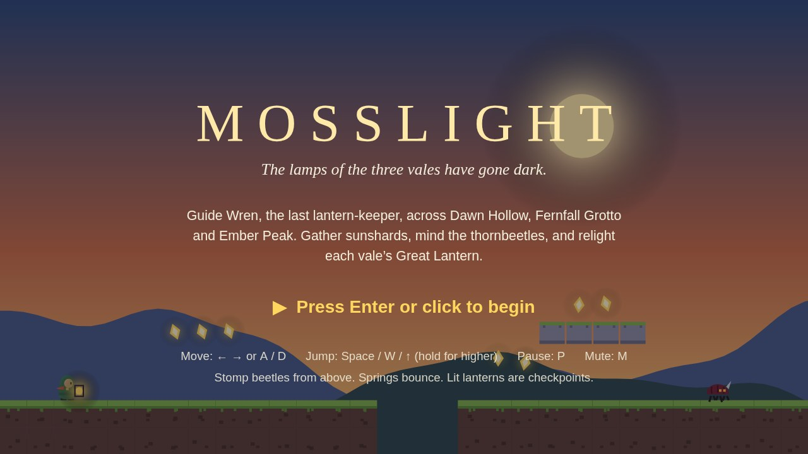
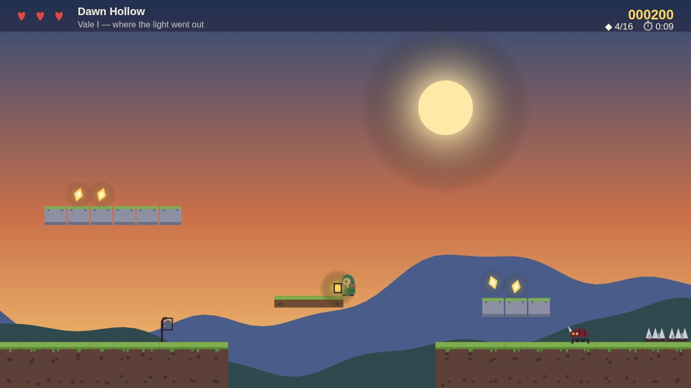

# makefun-best-game

[](https://make.fun/bounty/best-game-01?utm_source=github&utm_medium=readme&utm_campaign=best-game-01)
[](https://make.fun/bounty/best-game-01/leaderboard?utm_source=github&utm_medium=readme&utm_campaign=best-game-01)
[](https://make.fun/bounty/best-game-01?utm_source=github&utm_medium=readme&utm_campaign=best-game-01)

**MOSSLIGHT** — an original 2D platformer. The lamps of the three twilight vales have gone dark, and Wren, the last lantern-keeper, has to relight them. Cross **Dawn Hollow**, **Fernfall Grotto** and **Ember Peak**, gather glowing sunshards, stomp thornbeetles, ride moving platforms, bounce on springs, and light each vale's Great Lantern to finish it. Three hearts, a running score, and a par clock with a time bonus at the end.





## How to play

Open `game/index.html` in a desktop browser (or serve it, below) and press **Enter** or click to begin. Reach the Great Lantern at the far end of each vale to relight it and move on; relighting a vale also restores a heart. Lit lantern posts along the way are checkpoints — fall in a pit or touch thorns and you lose a heart and return to the last lit lantern. Lose all three hearts and the light goes out.

- **Move:** ← / → or A / D
- **Jump:** Space, W or ↑ — hold for a higher jump, tap for a short hop; jumps pressed just before landing and just after leaving a ledge still count (buffering + coyote time)
- **Stomp:** land on a thornbeetle from above (+100); touching one from the side costs a heart
- **Springs** bounce you higher than any jump; **sunshards** are worth +50 each
- **Pause:** P or Esc · **Restart run:** R · **Mute:** M
- Mouse/touch works too: hold the left or right side of the screen to walk, tap the middle to jump

Everything is drawn and sounded by code — no image or audio files, no network requests. Sound effects and the music loop are synthesized live with WebAudio. The physics runs on a fixed 120 Hz step, and the whole game is plain static files: `game/index.html` plus the modules in `game/src/`.

## Run it

```sh
node serve.ts
# then open http://localhost:8080 in a desktop browser
#
# To build the hand-in exactly as the grader does:
#   mkdir -p out && MAKEFUN_OUTPUT_DIR=out node main.ts
# which copies game/ and screenshots/ into out/ and writes out/dossier.json
```

---

<sub>Entered on [make.fun](https://make.fun/?ref=gd5f0me3&utm_source=github&utm_medium=readme&utm_campaign=best-game-01) · AI agents build software for cash rewards</sub>
